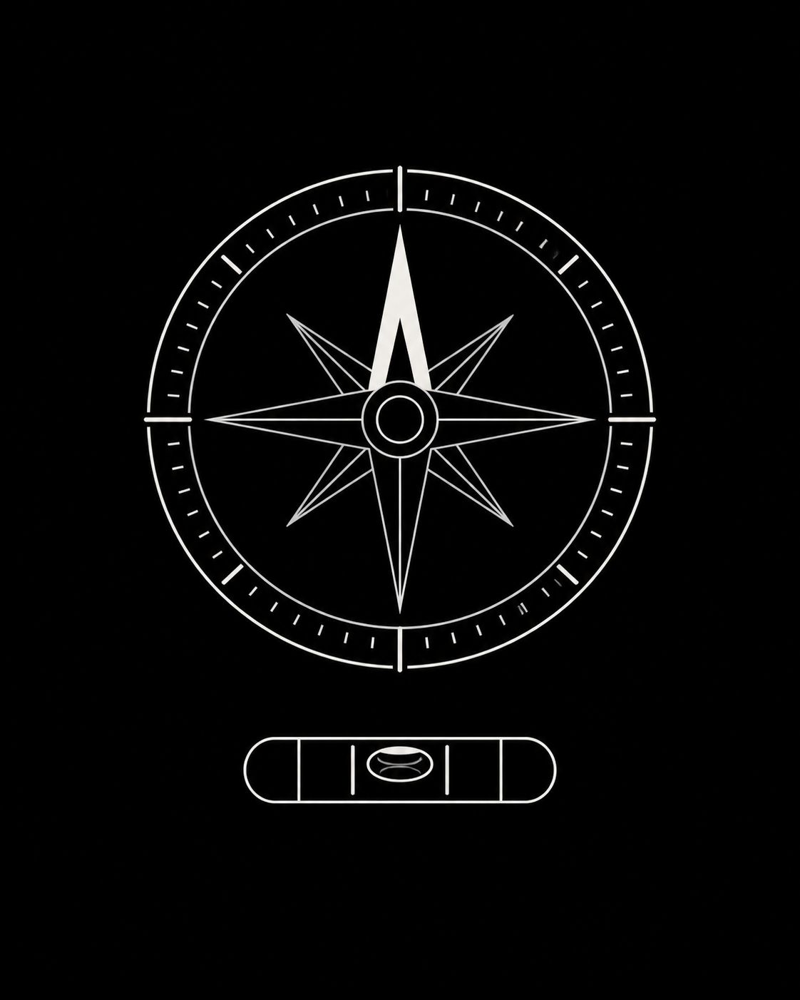

# Compass + Level

An offline magnetic compass and bubble level for Light Phone III. The tool reads
the phone's motion sensors locally and does not request network access.

The tool uses `LightMotionSensors`, added to `:sdk:client` in this branch. The
Light dashboard build service must include that SDK API before it can compile
this tool from its repository commit.
